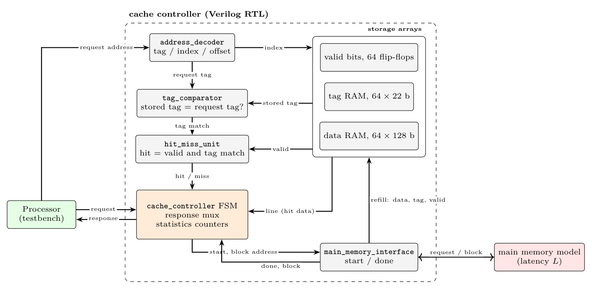
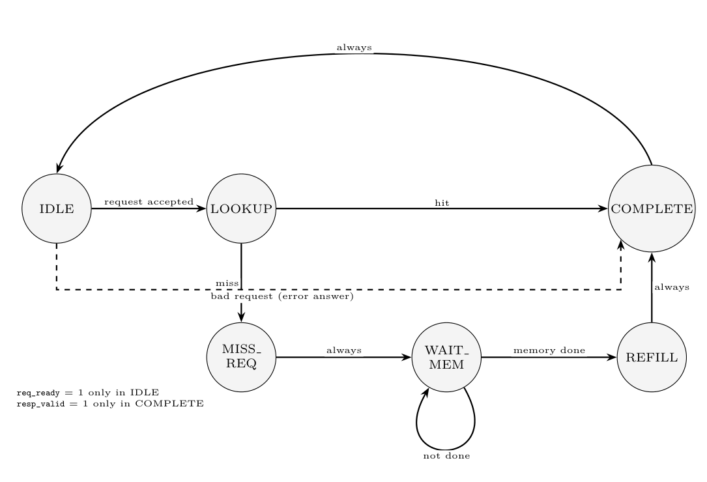

# Direct-Mapped Cache Controller

**Modern Computer Architecture (MCA) project.** A synthesizable Verilog direct-mapped cache controller (1 KB, 16-byte blocks, 64 lines) that sits between a processor and a
simulated main memory. It detects hits and misses, refills a line from memory on a miss, and counts hits, misses and cycles. It is checked by unit tests for every
module, a 12-test self-checking system testbench and a 16-run regression, and its hit rate and average memory access time (AMAT) are measured for five access patterns.
Everything here is simulation (Icarus Verilog) and synthesis (Yosys) on macOS; **nothing was run on physical hardware.**

## Project deliverables

| Deliverable | Location |
|---|---|
| IEEE project report (PDF) | [`report/IEEE_Report_Final.pdf`](report/IEEE_Report_Final.pdf) |
| IEEE report source (LaTeX, IEEEtran) | [`report/`](report/) |
| Literature review and references | [`docs/literature_review.md`](docs/literature_review.md) |
| RTL source | [`rtl/`](rtl/) |
| Testbenches (unit, system, performance) | [`testbench/`](testbench/) |
| Diagrams (SVG and PNG, TikZ sources) | [`diagrams/`](diagrams/) |
| Waveform images and VCD generation | [`docs/images/`](docs/images/); VCDs regenerate into `simulation/waveforms/` |
| Verification, performance and synthesis notes | [`docs/verification.md`](docs/verification.md), [`docs/perf_results.md`](docs/perf_results.md), [`docs/synthesis.md`](docs/synthesis.md) |
| Yosys scripts and reports | [`synth/`](synth/) |

## Cache configuration

| Property | Value |
|---|---|
| Address width / data width | 32 bits (byte addressed) / 32-bit words (word-aligned accesses) |
| Capacity / block size / lines | 1 KB / 16 bytes / 64 |
| Tag / index / offset | 22 / 6 / 4 bits |
| Mapping | direct mapped (one line per index, no replacement policy) |
| Line contents | valid bit + 22-bit tag + 128-bit data block |
| Backing memory | 64 KB behavioural model, configurable latency L (1 to 16 tested), deterministic contents |
| Write policy | read-only; write requests return an error (write-through is future work) |

**Address format**

```
  bit:  31                      10 9        4 3     0
       +--------------------------+----------+-------+
       |        TAG (22)          | INDEX(6) |OFF (4)|
       +--------------------------+----------+-------+
  index = (addr / 16) mod 64      tag = addr / 1024      offset[3:2] picks the word
```

Addresses 0 and 1024 have the same index (line 0) and different tags, so they evict each other: that is a conflict miss.

## Architecture



| Module | File | Purpose |
|---|---|---|
| `cache_controller` | [`rtl/cache_controller.v`](rtl/cache_controller.v) | Top level: 6-state FSM, request handshake, response, statistics counters |
| `address_decoder` | [`rtl/address_decoder.v`](rtl/address_decoder.v) | Splits an address into tag, index, offset and block address |
| `cache_data_ram` | [`rtl/cache_data_ram.v`](rtl/cache_data_ram.v) | 64 x 16-byte data array (16 byte-lane RAMs) |
| `cache_tag_ram` | [`rtl/cache_tag_ram.v`](rtl/cache_tag_ram.v) | One 22-bit tag per line |
| `cache_valid_ram` | [`rtl/cache_valid_ram.v`](rtl/cache_valid_ram.v) | 64 valid flip-flops, all cleared by reset |
| `tag_comparator` | [`rtl/tag_comparator.v`](rtl/tag_comparator.v) | Stored tag equal to request tag? |
| `hit_miss_unit` | [`rtl/hit_miss_unit.v`](rtl/hit_miss_unit.v) | `hit = valid && tag_match`; an invalid line always misses |
| `main_memory_interface` | [`rtl/main_memory_interface.v`](rtl/main_memory_interface.v) | Memory-side start/done protocol; request held until memory accepts |

Simulation-only models are in `testbench/`: `main_memory_model.v` (configurable latency, optional back-pressure) and `reference_memory.v` (independent golden model).
The controller never touches the memory array; every access goes through the memory interface.

### Controller FSM



| Path | States | Latency (accept to `resp_valid`) |
|---|---|---|
| Hit | IDLE, LOOKUP, COMPLETE | 2 cycles |
| Miss | IDLE, LOOKUP, MISS_REQ, WAIT_MEM, REFILL, COMPLETE | L + 7 cycles |
| Bad request (misaligned, out of range, write) | IDLE, COMPLETE | 1 cycle, `resp_err = 1` |

Miss penalty = L + 5 cycles (extra cycles beyond a hit). AMAT = hit time + miss rate x miss penalty. Details: [`docs/fsm_design.md`](docs/fsm_design.md), [`docs/architecture.md`](docs/architecture.md).

## Running the simulations

Requirements: [Icarus Verilog](https://steveicarus.github.io/iverilog/) and [Yosys](https://yosyshq.net/yosys/); optional [GTKWave](https://gtkwave.sourceforge.net/),
Python 3 with matplotlib and PyMuPDF (for plots), and `pdflatex` (for the report).

```bash
brew install icarus-verilog yosys
brew install --cask gtkwave                                # optional
python3 -m venv .venv && .venv/bin/pip install matplotlib pymupdf   # optional: plots and diagrams
```

```bash
make compile                  # iverilog -Wall on RTL and testbenches, Yosys elaboration check
make test                     # all unit tests + the 12-test system testbench (LAT=4)
make regression               # 16 runs: latency 1/2/4/8/16, memory back-pressure, extra seeds
make wave TEST=conflict       # complete VCD for one test -> simulation/waveforms/ (make wave lists the names)
make synth                    # Yosys generic + iCE40 flows -> synth/
make perf                     # workloads -> docs/perf_results.md, docs/performance.csv, docs/images/
make diagrams waveforms report   # SVG/PNG diagrams, waveform figures, IEEE report PDF
```

Single commands without `make`:

```bash
iverilog -g2012 -s tb_tag_comparator -o tb.vvp rtl/*.v testbench/tb_tag_comparator.v && vvp tb.vvp        # any unit test
gtkwave simulation/waveforms/direct_mapped_conflict_lat4.vcd                                             # view a waveform
```

### Test results (Icarus Verilog 13.0)

| Testbench | Module / scope | Checks | Result |
|---|---|---|---|
| `tb_address_decoder` | `address_decoder` | 40005 | PASS |
| `tb_tag_comparator` | `tag_comparator` | 5091 | PASS |
| `tb_hit_miss_unit` | `hit_miss_unit` | 8 | PASS |
| `tb_storage` | data, tag and valid RAMs | 74 | PASS |
| `tb_cache_controller` T1 cold_miss | whole controller | 17 | PASS |
| T2 repeated_access | | 18 | PASS |
| T3 same_block_accesses | | 21 | PASS |
| T4 direct_mapped_conflict | | 36 | PASS |
| T5 different_cache_lines | | 399 | PASS |
| T6 sequential_access | | 1547 | PASS |
| T7 reset | | 34 | PASS |
| T8 memory_latency | | 18 | PASS |
| T9 request_handshake | | 57 | PASS |
| T10 randomized (5000 requests) | | 5009 | PASS |
| T11 boundary_and_errors | | 43 | PASS |
| T12 conflict_100_1124_104 | | 28 | PASS |

`make regression`: **16 of 16 runs pass** (4 unit tests; system testbench at latency 1, 2, 4, 8, 16; back-pressure of 1 and 3 cycles; random seeds 2, 3, 4).
Test list, method, protocol checker and limits: [`docs/verification.md`](docs/verification.md).
Bug injection: 12 of 13 injected RTL bugs fail the system tests; the 13th (ignoring tag bit 21) cannot change any result with a 64 KB memory, and its unit test fails.

## Key results

Measured at memory latency 4 (`docs/perf_results.md`). Each trace starts from an empty cache.

| Workload | Hit rate | AMAT (cycles) |
|---|---|---|
| repeated (16 hot words) | 99.8% | 2.02 |
| sequential (one pass, 16 KB) | 75.0% | 4.25 |
| random_hot (80% in 512 bytes) | 70.1% | 4.69 |
| random (64 KB) | 1.4% | 10.88 |
| conflict (addresses 0 and 1024) | 0.0% | 11.00 |


Hit time is 2 cycles and the miss penalty is L + 5. The AMAT formula equals the directly measured average latency for every workload.
Sequential access misses once per 4-word block (25%); the conflict trace shows why a direct-mapped cache can miss on every access even though 63 lines are unused.

## Synthesis (Yosys estimates)

iCE40-style flow, flattened: **635 LUT4, 487 flip-flops, 18 block RAMs** (data 16, tag 2; valid bits are flip-flops). With no RAM macro (generic flow) the memories become
about 10k flip-flops. These are software estimates, not FPGA utilisation measurements; there is no place-and-route and no timing analysis.
Details and warnings: [`docs/synthesis.md`](docs/synthesis.md), [`synth/SUMMARY.md`](synth/SUMMARY.md).

## Design scope and limitations

- **Read-only cache.** `req_we` returns `resp_err`; write-through with write-allocate is future work (the data RAM already has a byte-mask port).
- **One outstanding request** (blocking cache); word-aligned 32-bit accesses only.
- **Behavioural memory model** (`testbench/main_memory_model.v`): never returns errors; the controller does not depend on how it is built.
- **Synthetic traces**; no real program was run.
- **Statistics counters** use about half the flip-flops; they could be made optional.
- **No timing analysis** and no hardware validation.

## Repository structure

```
.
├── rtl/                    Verilog RTL modules
├── testbench/              unit tests, system testbench (tb_cache_controller), tb_perf, memory models, test_vectors/
├── scripts/                compile.sh, run_tests.sh, regression.sh, run_wave.sh, run_synthesis.sh, Python analysis and figure scripts
├── synth/                  Yosys scripts (*.ys) and reports (*_stat.txt, SUMMARY.md)
├── simulation/             logs/ (LAT=4 log and regression summary tracked), waveforms/ (generated VCDs)
├── diagrams/               block diagram and FSM (TikZ source, SVG, PNG)
├── docs/                   architecture, FSM, verification, synthesis, performance, literature review, images/
├── report/                 IEEE report (main.tex, IEEE_Report_Final.pdf, figures/)
├── Makefile
└── README.md
```

Generated VCD files, most logs and Yosys logs are not tracked; `make regression`, `make wave` and `make synth` recreate them.

## Team

The team names and roles below are placeholders; fill them in (the same table is in the report).

| Member | Role | Responsibilities |
|---|---|---|
| [Member 1] | Architecture and Integration | Architecture and signal definitions, cache controller FSM, integration, system testbench |
| [Member 2] | Cache Storage and Hit Logic | Address decoder, tag/valid/data storage, tag comparator, hit/miss unit, unit tests |
| [Member 3] | Verification and Simulation | Memory interface and model, reference model, regression, bug injection, waveforms |
| [Member 4] | Analysis and Documentation | Workloads and AMAT analysis, Yosys synthesis, diagrams, literature review, README, IEEE report |

## References

1. J. L. Hennessy and D. A. Patterson, *Computer Architecture: A Quantitative Approach*, 6th ed., Morgan Kaufmann, 2017.
2. M. D. Hill, "A case for direct-mapped caches," *Computer*, vol. 21, no. 12, pp. 25-40, 1988.
3. N. P. Jouppi, "Improving direct-mapped cache performance by the addition of a small fully-associative cache and prefetch buffers," *Proc. 17th ISCA*, 1990, pp. 364-373.
4. Icarus Verilog, "Getting Started With Icarus Verilog." https://steveicarus.github.io/iverilog/usage/getting_started.html

More sources: [`docs/literature_review.md`](docs/literature_review.md).
