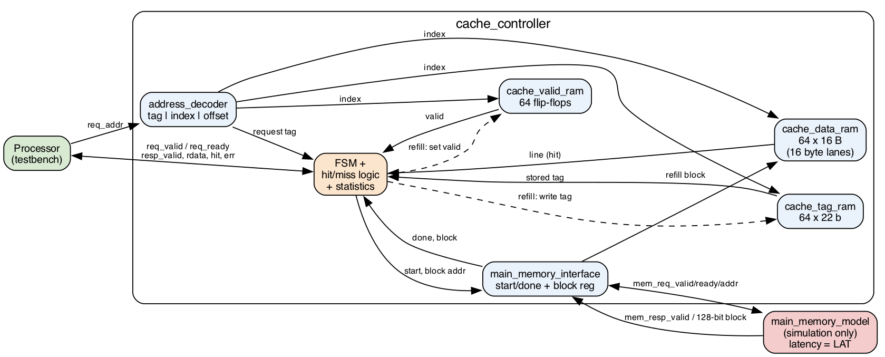

# Direct-Mapped Cache Controller (Modern Computer Architecture project)

A synthesizable Verilog direct-mapped cache controller placed between a processor and a simulated main memory, with a self-checking
testbench, automated regression, waveform generation, Yosys synthesis reports and measured hit-rate / AMAT analysis.
Everything here is simulation (Icarus Verilog) and synthesis (Yosys) on macOS; **nothing was run on physical hardware.**

## Problem statement and objectives
Design a direct-mapped cache controller and analyse cache hit/miss behaviour using representative access traces. The controller splits
each address into tag, index and offset, checks the valid bit and tag, serves hits from the cache, fetches a 16-byte block from main memory on a
miss, refills the selected line, and returns the data. Objectives: correct lookup and refill, valid-bit handling, hit/miss statistics, AMAT analysis, verification and synthesis results.

## Architecture
| Parameter | Value |
|---|---|
| Type / write policy | direct mapped, read-only (writes return `resp_err`; write-through is a planned extension) |
| Address | 32-bit, byte addressed, word-aligned accesses |
| Capacity / block / lines | 1 KB / 16 bytes / 64 |
| Tag / index / offset | `addr[31:10]` (22 b) / `addr[9:4]` (6 b) / `addr[3:0]` (4 b) |
| Line contents | valid bit + 22-bit tag + 128-bit block |
| Hit | `valid[index] && tag[index] == request tag` |



**FSM** (`rtl/cache_controller.v`): hit `IDLE -> LOOKUP -> COMPLETE` (2 cycles); miss `IDLE -> LOOKUP -> MISS_REQ -> WAIT_MEM -> REFILL -> COMPLETE`
(LAT + 7 cycles for memory latency LAT). Details and diagram: [docs/fsm_design.md](docs/fsm_design.md); design notes: [docs/architecture.md](docs/architecture.md).

| RTL module (`rtl/`) | Role |
|---|---|
| `address_decoder` | tag / index / offset / block address from parameters |
| `cache_data_ram`, `cache_tag_ram`, `cache_valid_ram` | storage: 16 byte-lane RAMs; tag RAM; 64 reset-cleared valid flip-flops |
| `main_memory_interface` | memory-side protocol: start/done toward the controller, request held until accepted |
| `cache_controller` | top level: FSM, hit/miss logic, response mux, statistics counters |

Simulation-only models are in `sim/` (`main_memory_model` with configurable latency and optional back-pressure, `reference_memory`, testbenches); synthesizable RTL and testbench code are kept separate.

## Requirements and setup (macOS, Homebrew)
```bash
brew install icarus-verilog yosys graphviz
brew install --cask gtkwave                                # optional: view waveforms
python3 -m venv .venv && .venv/bin/pip install matplotlib   # only for `make perf` / `make waves`
```
Tested with Icarus Verilog 13.0 and Yosys 0.70.

## Commands
| Command | What it does |
|---|---|
| `make compile` | `iverilog -Wall` on RTL and testbenches, Yosys elaboration check |
| `make test [LAT=4]` | unit tests + the 12-test system testbench at one memory latency; non-zero exit on failure |
| `make regression` | latency 1/2/4/8/16, memory back-pressure, extra seeds (14 runs); summary in `results/simulation_logs/regression_summary.txt` |
| `make wave TEST=<name> [LAT=4]` | complete VCD for one test in `results/waveforms/`; `make wave` lists names (e.g. `conflict_miss`, `conflict_100_1124_104`, `all`) |
| `make synth` | Yosys generic and iCE40 flows (`synth/*.ys`) -> `results/synthesis/` incl. `SUMMARY.md` |
| `make clean` | remove generated logs, VCDs and binaries |
| `make perf` | workload traces -> hit rate and AMAT CSVs and plots in `results/performance/` |
| `make waves`, `make report` | regenerate diagrams / the IEEE report PDF (needs graphviz, pdflatex) |

View a waveform: `gtkwave results/waveforms/direct_mapped_conflict_lat4.vcd`.

## Verification results
12 self-checking tests, each with an expected result, plus unit tests and a memory-protocol checker. Last `make regression`: **14 of 14 runs pass**
(latency 1-16, back-pressure, seeds). Test list, expected vs actual, method and limits: [docs/verification.md](docs/verification.md).
The brief's conflict example passes: 100 -> 1124 -> 100 = MISS MISS MISS, then 100 -> 104 = MISS HIT.

## Performance (measured, LAT = 4; `results/performance/performance.csv`)
| Workload | Hit rate | AMAT (cycles) |
|---|---|---|
| repeated | 99.8% | 2.02 |
| sequential | 75.0% | 4.25 |
| random_hot | 70.1% | 4.69 |
| random | 1.4% | 10.88 |
| conflict | 0.0% | 11.00 |

Hit time 2 cycles, miss penalty LAT + 5. The formula and the measured average latency agree for every workload.

## Synthesis results (Yosys estimates, no place-and-route or timing)
iCE40-style flow, flattened: **635 LUT4, 487 flip-flops, 18 block RAMs** (data 16, tag 2; valid bits are flip-flops). The generic flow, which has no RAM macro,
gives 26160 cells with 10237 flip-flops because the memories become registers. Warnings, per-module numbers and interpretation:
[docs/synthesis.md](docs/synthesis.md), [results/synthesis/SUMMARY.md](results/synthesis/SUMMARY.md). These are not FPGA utilisation measurements.

## Repository layout
```
rtl/        synthesizable design
sim/        memory models, testbenches (tb_cache_controller, tb_perf, tb_integration, unit/), test_vectors/
scripts/    compile.sh, run_tests.sh, regression.sh, run_wave.sh, run_synthesis.sh, analyze_results.py, ...
synth/      Yosys scripts (generic and iCE40, flat and hierarchical)
results/    simulation_logs/ (LAT=4 log and regression summary tracked), performance/, synthesis/ (reports tracked), waveforms/ (generated)
docs/       architecture.md, fsm_design.md, verification.md, synthesis.md, diagrams/
report/     IEEE report (main.tex, PDF, figures)
extras/     optional browser portal for viewing runs and waveforms (not needed for the core flow): extras/portal/README.md
```
Generated VCDs, synthesis logs/JSON and most simulation logs are not tracked; `make regression`, `make wave` and `make synth` recreate them.

## Limitations and future work
Read-only (write-through/write-allocate planned); one outstanding request; word accesses only; synthetic traces; the memory model never reports errors;
statistics counters take about half the flip-flops; no timing analysis. Possible extensions: write policy, size/block-size sweeps, a 2-way comparison,
optional counters, place-and-route timing.

## Team contributions
See the Individual Contributions table in `report/main.tex` (team names still to be filled in by the team).
