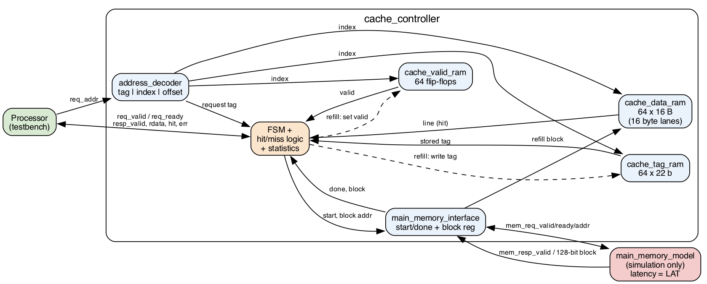

# Architecture (as built)

## Parameters (derived in one place)
| Parameter | Value | Derivation |
|---|---|---|
| `ADDR_WIDTH` | 32 | given |
| `CACHE_BYTES` / `BLOCK_BYTES` | 1024 / 16 | given |
| `NUM_LINES` | 64 | `CACHE_BYTES / BLOCK_BYTES` |
| `OFFSET_W` | 4 | `$clog2(BLOCK_BYTES)` |
| `INDEX_W` | 6 | `$clog2(NUM_LINES)` |
| `TAG_W` | 22 | `ADDR_WIDTH - INDEX_W - OFFSET_W` |

Address split: `tag = addr[31:10]`, `index = addr[9:4]`, `offset = addr[3:0]` (word select = `offset[3:2]`).
`address_decoder` refuses to elaborate if sizes are not powers of two (tested), and its slicing is verified for the
default and a second geometry (2 KB, 32 B blocks).

Storage needed: data 64 × 128 b = 8192 b, tags 64 × 22 b = 1408 b, valid 64 b.

## Modules (`rtl/`)
| Module | Role |
|---|---|
| `address_decoder` | tag / index / offset / block-aligned address, parameter-derived |
| `cache_data_ram` | 64 lines × 16 B as 16 byte-lane RAMs (synchronous read, per-byte write mask; mask is all ones for refills, ready for write support) |
| `cache_tag_ram` | one 22-bit tag per line, synchronous read/write |
| `cache_valid_ram` | 64 flip-flops (clear in one cycle on reset), synchronous read |
| `main_memory_interface` | memory-side protocol engine: controller says *start* + address, gets *done* + 128-bit block; holds `mem_req_valid` until memory accepts |
| `cache_controller` | FSM, hit/miss logic, response mux, seven statistics counters; instantiates all of the above |

Simulation only (`sim/`): `main_memory_model` (configurable latency, deterministic contents), `reference_memory`
(independent golden model), testbenches. The controller never accesses the memory array; everything passes through the
memory interface, so another memory with the same ports can replace the model.

## Design decisions
- **32-bit word interface, word-aligned.** A block is 4 words; the offset's upper two bits pick the word. Misaligned
  requests return `resp_err`.
- **Whole-block memory transfers** (128 bits per request/response) keep the refill simple: one request, one response.
- **Synchronous-read RAMs.** All three arrays are read at the accept edge, so tag/valid/data are ready in LOOKUP.
- **Valid bits in flip-flops, not RAM** — a RAM cannot be bulk-cleared by reset.
- **Data RAM as byte lanes** so synthesis can map it to block RAM (a first single-array version could not; see synthesis report).
- **Blocking cache**, one outstanding request.
- **Write policy:** this milestone is **read-only**. Write requests return `resp_err`. The planned extension is
  write-through with write allocate (no dirty bits); the byte-mask port in the data RAM is already in place. No write-back
  behavior exists anywhere in the design.

## Processor-side interface
| Signal | Dir | Meaning |
|---|---|---|
| `clk`, `rst_n` | in | clock; active-low synchronous reset |
| `req_valid` / `req_ready` | in / out | request accepted on the edge where both are 1; `req_ready` is high only in IDLE |
| `req_addr[31:0]` | in | byte address (word aligned, `< MEM_BYTES`) |
| `req_we`, `req_wdata`, `req_be` | in | write fields; unused in this milestone (`req_we=1` → error) |
| `resp_valid` | out | exactly one 1-cycle pulse per accepted request |
| `resp_rdata[31:0]` | out | read data, valid with `resp_valid` (0 on error) |
| `resp_hit`, `resp_err` | out | request hit the cache / request was bad |
| `stat_*` | out | requests, hits, misses, mem_reads, completed, cycles, mem_wait_cycles |

**Handshake rules.** The controller latches the address at the accept edge, so the CPU may change `req_addr` afterwards.
A request presented while the controller is busy waits; it is accepted exactly once when `req_ready` rises. A request
withdrawn before acceptance has no effect. These rules are tested (T9).

## Memory-side interface
`mem_req_valid` (held until `mem_req_ready`), `mem_req_addr` (block aligned), `mem_resp_valid` (1-cycle pulse),
`mem_resp_data[127:0]` (byte *i* of the block at bits `[8i +: 8]`). The model's `LATENCY` = clock edges from accept to
response pulse.

## Timing (measured)
Hit = 2 cycles (accept edge → LOOKUP → COMPLETE, counted to the edge where `resp_valid` is sampled). Miss = LAT + 7.
Miss penalty = LAT + 5. Memory-wait cycles per miss = LAT + 4. See the IEEE report in `report/` for the AMAT convention.
