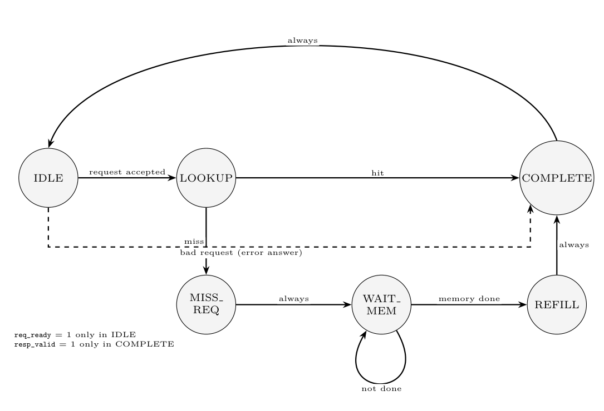
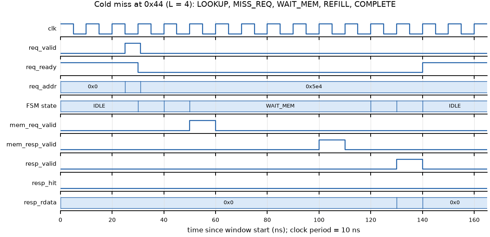

# Controller FSM

Six states, one request at a time. State is a registered 3-bit value; next state is combinational (`cache_controller.v`).

| State | Outputs / actions | Transition |
|---|---|---|
| **IDLE** | `req_ready=1`. On `req_valid` (the accept edge): latch address, set `err_q` if the request is bad, start reading data/tag/valid RAMs with the live index. | accept and request OK → LOOKUP; accept and bad (misaligned, ≥ `MEM_BYTES`, or write) → COMPLETE; no accept → IDLE |
| **LOOKUP** | RAM outputs are valid. `hit = valid && stored_tag == request_tag` (from `tag_comparator` and `hit_miss_unit`). Counts hit or miss. Records `hit_q`. | hit → COMPLETE; miss → MISS_REQ |
| **MISS_REQ** | Pulses `start` to `main_memory_interface` with the block-aligned address. Counts one memory read. | always → WAIT_MEM |
| **WAIT_MEM** | Interface requests the block and waits for `mem_resp_valid`. Counts memory-wait cycles. | `mem_done` → REFILL; else stay |
| **REFILL** | Writes the 128-bit block to the data RAM, the tag to the tag RAM, and sets the valid bit (all at index of the latched address). | always → COMPLETE |
| **COMPLETE** | `resp_valid=1`; `resp_rdata` = selected word (from the RAM read register on a hit, from the refill block register on a miss); `resp_hit=hit_q`; `resp_err=err_q`. | always → IDLE |

Why these choices:
- **LOOKUP is its own state** because the RAMs read synchronously: the data is available one cycle after the address.
- **MISS_REQ is separate from WAIT_MEM** so the controller issues exactly one start pulse per miss; the interface owns the
  request-hold-until-accepted behavior.
- **The miss response uses the block register, not a second RAM read**, so a miss does not pay an extra lookup.
- **COMPLETE always returns to IDLE**, which is what makes "one response per request" and "`req_ready` low while busy" hold.
- Every state has a defined next state (a `default` returns to IDLE), and no latch is inferred (checked in synthesis).

Cycle count: hit = IDLE(accept) → LOOKUP → COMPLETE = 2; miss = LOOKUP, MISS_REQ, WAIT_MEM (LAT + 4 cycles including the
memory interface's request cycle and response capture), REFILL, COMPLETE = LAT + 7. These were measured, not derived from the
diagram: hit 2 and miss LAT+7 hold for every request in every run at LAT = 1, 2, 4, 8, 16.

With memory back-pressure (`ACCEPT_DELAY` extra cycles of `mem_req_ready` low, simulation option) a miss takes LAT + 7 + ACCEPT_DELAY cycles;
the request is held in `main_memory_interface` (M_REQ) until accepted, and a protocol checker verifies exactly one request per miss.

Waveform of a cold miss followed by two hits (LAT = 4, from simulation):

