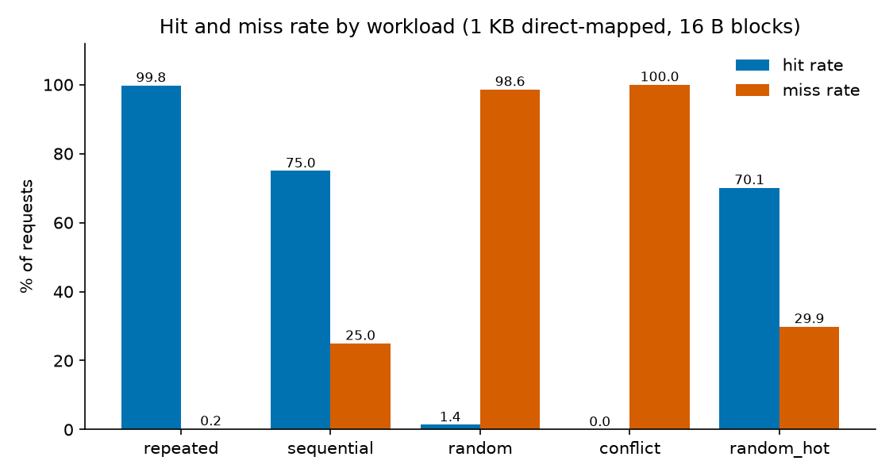
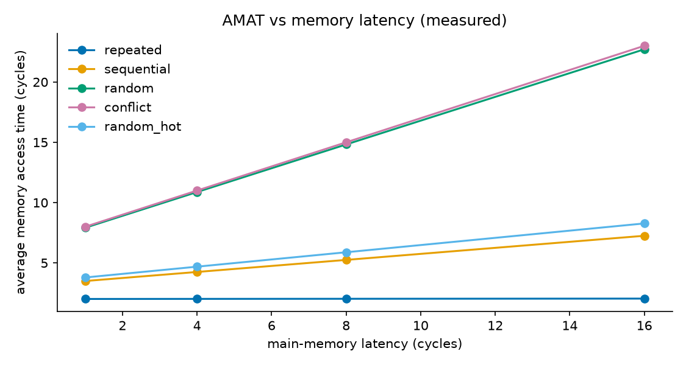

# Performance results

Generated by `scripts/analyze_results.py` (`make perf`) from simulation counters; nothing here is typed in.
Configuration: 1 KB direct-mapped cache, 16-byte blocks, 64 lines, 64 KB memory model. Each trace runs from an empty cache with
back-to-back requests.

**Timing convention.** Request latency = clock edges from the accept edge to the edge where `resp_valid` is sampled. Hit time is the
latency of a hit; miss penalty is the *extra* cycles of a miss (miss latency - hit time), so AMAT = hit time + miss rate x miss penalty
does not count the lookup twice. The average latency is also measured directly and equals the formula in every run.

## Results at memory latency 4

| Workload | Requests | Hits | Misses | Hit rate | Miss rate | Hit time | Miss penalty | AMAT (cycles) |
|---|---|---|---|---|---|---|---|---|
| repeated | 2000 | 1996 | 4 | 99.8% | 0.2% | 2 | 9 | 2.02 |
| sequential | 4096 | 3072 | 1024 | 75.0% | 25.0% | 2 | 9 | 4.25 |
| random | 4000 | 55 | 3945 | 1.4% | 98.6% | 2 | 9 | 10.88 |
| conflict | 2000 | 0 | 2000 | 0.0% | 100.0% | 2 | 9 | 11.00 |
| random_hot | 4000 | 2805 | 1195 | 70.1% | 29.9% | 2 | 9 | 4.69 |

## AMAT (cycles) versus memory latency

| Workload | L=1 | L=4 | L=8 | L=16 |
|---|---|---|---|---|
| repeated | 2.01 | 2.02 | 2.03 | 2.04 |
| sequential | 3.50 | 4.25 | 5.25 | 7.25 |
| random | 7.92 | 10.88 | 14.82 | 22.71 |
| conflict | 8.00 | 11.00 | 15.00 | 23.00 |
| random_hot | 3.79 | 4.69 | 5.88 | 8.27 |

Raw per-run numbers (cycles, memory-wait cycles, latency sums) are in `docs/performance.csv`.
