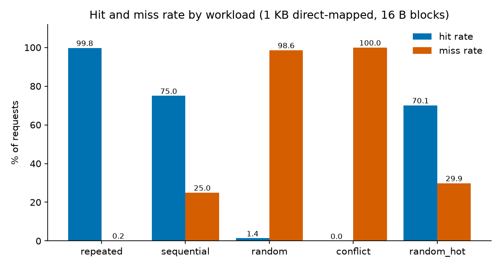
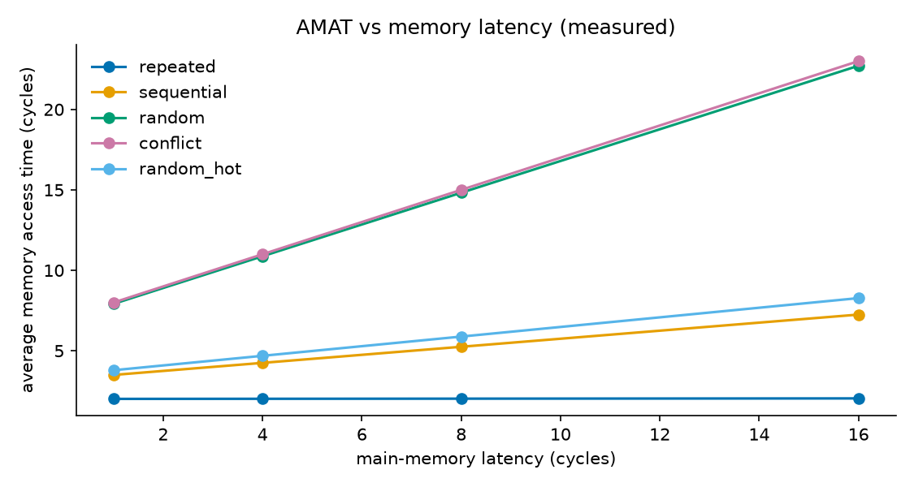

# Performance Report (milestone 1: read-only cache)

Reproduce: `make perf` (generates traces, runs the RTL, writes CSVs and plots). Every number below was copied from
`results/performance/performance.csv`, which is produced from simulator counters by `scripts/analyze_results.py`.
Configuration: 1 KB direct-mapped cache, 16-byte blocks, 64 lines, 64 KB main memory.

## Timing convention (no overlap, no double counting)
- **Request latency** = clock edges from the edge where the request is accepted to the edge where `resp_valid` is sampled.
- **Hit time** = latency of a hit = **2 cycles** (lookup is included in it).
- **Miss penalty** = (miss latency) − (hit time) = **LAT + 5** cycles, i.e. only the *extra* cycles beyond a hit. Miss latency is LAT + 7.
- **AMAT = hit time + miss rate × miss penalty.** Because the penalty is extra time, the hit time is counted once for every request.
- Hit time and miss penalty are measured over all runs at each latency (a workload with no hits cannot measure its own hit time).
- **Cross-check:** the script also measures the average latency directly (sum of per-request latencies / requests). The two
  agree to 1e-9 for all 20 runs, which confirms AMAT is not double counted.
- **cycles/request** is end-to-end throughput with back-to-back requests. It is about 1 higher than AMAT because the controller
  spends one cycle in IDLE before accepting the next request (`req_ready` is high only in IDLE). It is not part of AMAT.
- Statistics are counted from a cold cache (all lines invalid), so every workload includes its compulsory misses.

## Workloads (`sim/test_vectors/*.hex`, generated with a fixed seed)
| name | description |
|---|---|
| repeated | 2000 reads cycling over 16 hot words (4 blocks) |
| sequential | one pass over 16 KB, 4096 words |
| random | 4000 uniform random words over the full 64 KB |
| conflict | 2000 reads ping-ponging between addresses 0..12 and 1024..1036 (same lines, different tags) |
| random_hot (extra) | 80% of reads inside a 512-byte hot region, 20% anywhere in 64 KB |

## Results at memory latency 4
| workload | requests | hits | misses | hit rate | miss rate | hit time | miss penalty | AMAT | cycles/request |
|---|---|---|---|---|---|---|---|---|---|
| repeated | 2000 | 1996 | 4 | 99.8% | 0.2% | 2 | 9 | 2.02 | 3.02 |
| sequential | 4096 | 3072 | 1024 | 75.0% | 25.0% | 2 | 9 | 4.25 | 5.25 |
| random | 4000 | 55 | 3945 | 1.4% | 98.6% | 2 | 9 | 10.88 | 11.88 |
| conflict | 2000 | 0 | 2000 | 0.0% | 100.0% | 2 | 9 | 11.00 | 12.00 |
| random_hot | 4000 | 2805 | 1195 | 70.1% | 29.9% | 2 | 9 | 4.69 | 5.69 |

## AMAT versus memory latency (cycles)
| workload | LAT=1 | LAT=4 | LAT=8 | LAT=16 |
|---|---|---|---|---|
| repeated | 2.01 | 2.02 | 2.03 | 2.04 |
| sequential | 3.50 | 4.25 | 5.25 | 7.25 |
| random | 7.92 | 10.88 | 14.82 | 22.71 |
| conflict | 8.00 | 11.00 | 15.00 | 23.00 |
| random_hot | 3.79 | 4.69 | 5.88 | 8.27 |

## What the numbers show
- **repeated**: only the 4 compulsory misses; AMAT is essentially the 2-cycle hit time, and barely moves with memory latency.
- **sequential**: exactly 25% misses — one miss per 4-word block, the benefit of 16-byte blocks (spatial locality).
  Larger blocks would lower this further; that is an optional extension.
- **random**: hit rate 1.4%. A 1 KB cache over 64 KB of uniformly random addresses holds about 1/64 of the space, and the
  hits are the few cases where the address lands in an already-cached block. AMAT is dominated by the miss penalty.
- **conflict**: 0 hits even though only 2 blocks are involved. Both map to the same line, so each evicts the other.
  This is the weakness of direct mapping that a 2-way set-associative cache would remove (optional extension).
- **random_hot**: 70% hit rate from temporal locality; the 20% wide accesses cause most of the misses.
- Memory-wait cycles per miss equal LAT + 4 in every run (`mem_wait_per_miss` column).

## Limitations of these measurements
- The model is a blocking in-order cache with one outstanding request; there is no overlap of misses.
- Traces are synthetic, not from real programs. Read-only (no writes yet).
- Results are RTL simulation cycle counts, not clock-time: no frequency is implied until synthesis timing is known.
