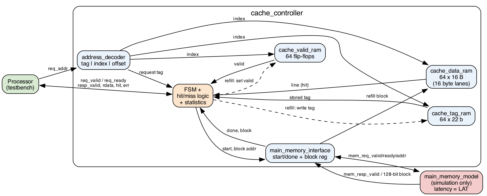
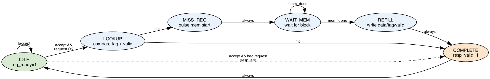
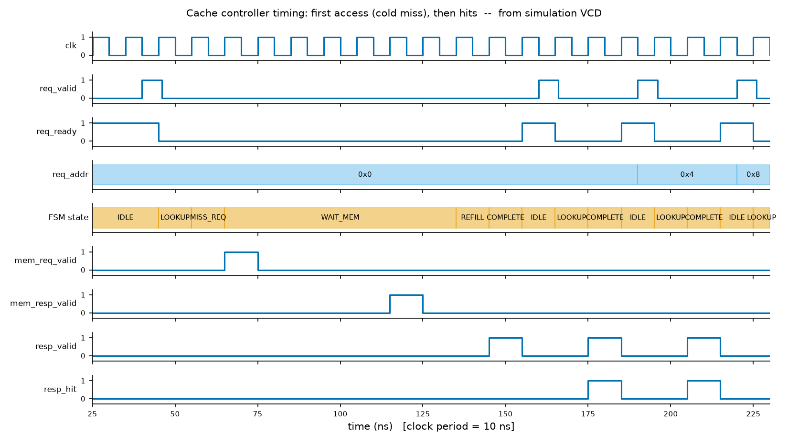
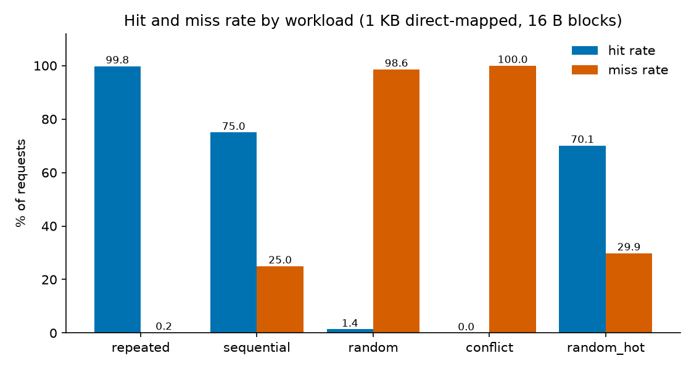
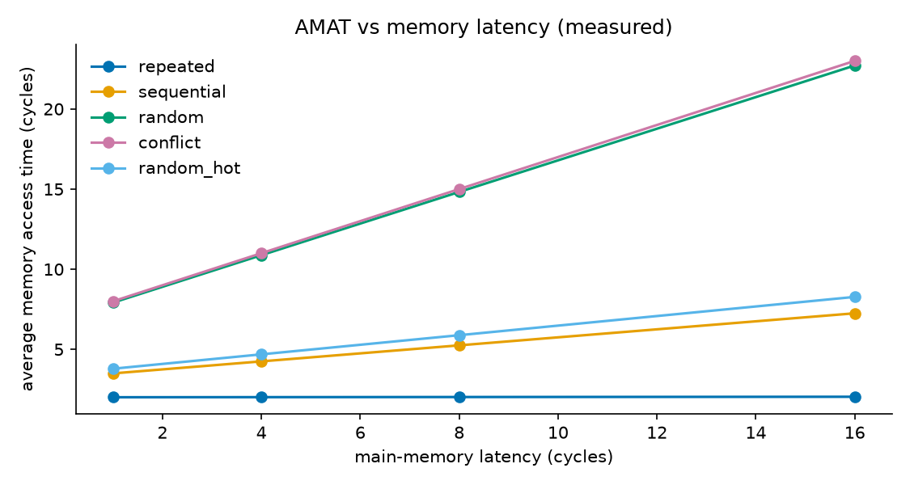

# Direct-Mapped Cache Controller — Technical Report

All figures in this report were produced by the simulations and synthesis runs in this repository
(`make all` regenerates them). No physical hardware was used.

## 1. Abstract
This project designs, verifies and analyzes a synthesizable direct-mapped cache controller in Verilog: a 1 KB cache with
16-byte blocks and 64 lines, a six-state controller FSM, a block-oriented main-memory interface with configurable latency,
and a self-checking testbench with an independent reference model. The read-only cache passes 11 tests (directed and
5000-request random) at five memory latencies. Measured hit time is 2 cycles and miss penalty is LAT + 5 cycles; hit rates
range from 99.8% (repeated) to 0% (conflict). Yosys estimates 635 LUT4, 487 flip-flops and 18 block RAMs for an FPGA-style mapping.

## 2. Problem statement
Main memory is far slower than a processor, so sending every request to memory is costly. A cache keeps copies of recently
used blocks. The task is to build the controller that decodes addresses, detects hits and misses, returns hit data,
fetches and installs a block on a miss, keeps valid bits and tags correct, and reports performance statistics.

## 3. Motivation and objectives
Understand direct-mapped organization; write synthesizable RTL; implement lookup, hit/miss detection and refill with an FSM;
verify with directed and random tests; measure hit rate, miss rate and AMAT under different access patterns; synthesize and
estimate resources.

## 4. Background
Programs show temporal locality (reuse of data) and spatial locality (use of nearby data). A cache exploits both: blocks
bring neighbors along, and recently used blocks stay. Average memory access time is
AMAT = hit time + miss rate × miss penalty. In a direct-mapped cache each memory block can live in exactly one line, chosen by
the index bits, which makes lookup cheap but allows conflict misses when blocks that share an index are used alternately.

## 5. Direct-mapped cache architecture
See `architecture.md`. The address is split into tag, index and offset; the index selects a line; the line's valid bit and
stored tag decide hit or miss; on a miss the block is fetched from memory and written to that line.

## 6. Parameter calculations
Cache 1024 B / block 16 B = 64 lines. Offset = log2(16) = 4 bits; index = log2(64) = 6 bits; tag = 32 − 6 − 4 = 22 bits.
Storage: data 64 × 128 = 8192 bits, tags 64 × 22 = 1408 bits, valid 64 bits.

## 7. Tag, index and offset derivation
`tag = addr[31:10]`, `index = addr[9:4]`, `offset = addr[3:0]`. Example: address 0x0000_0400 → tag 1, index 0, offset 0, and
address 0x0000_0000 → tag 0, index 0, offset 0. They share index 0 but differ in tag, so they conflict. The decoder is
parameterized and verified against plain bit slicing for 20,000 random addresses in two geometries.

## 8. Block diagram
See Section 5.

## 9. Controller FSM
IDLE → LOOKUP → COMPLETE (hit); LOOKUP → MISS_REQ → WAIT_MEM → REFILL → COMPLETE (miss); IDLE → COMPLETE (bad request).
Every transition is explained in `fsm_design.md`.

## 10. Module descriptions
`address_decoder`, `cache_data_ram` (16 byte-lane RAMs), `cache_tag_ram`, `cache_valid_ram` (flip-flops),
`main_memory_interface` (start/done protocol engine), `cache_controller` (FSM, hit logic, response, counters). Simulation-only:
`main_memory_model`, `reference_memory`. Details in `architecture.md`.

## 11. Interface and handshake specification
A request is accepted on the edge where `req_valid && req_ready`; `req_ready` is high only in IDLE. The address is latched at
accept. Exactly one `resp_valid` pulse follows each accepted request. Requests presented while busy wait; withdrawn requests
have no effect. The memory side holds `mem_req_valid` until `mem_req_ready` and returns the 128-bit block with a one-cycle
`mem_resp_valid`. Full tables in `architecture.md`.

## 12. Design assumptions and write policy
Blocking cache, 32-bit aligned word reads, 64 KB memory range (`MEM_BYTES`), reset is synchronous active-low.
**This milestone is read-only.** A write request returns `resp_err`. The planned extension is write-through with write-allocate
and byte enables (no dirty bits); write-back is not part of the design.

## 13. Implementation details
Parameters are derived from `ADDR_WIDTH`, `CACHE_BYTES`, `BLOCK_BYTES`. All three arrays are read at the accept edge so results
are ready in LOOKUP. The miss response is taken from the refill block register, so a miss does not pay a second lookup.
Valid bits are flip-flops so reset clears them in one cycle. Seven 32-bit counters record requests, hits, misses, memory reads,
completions, cycles and memory-wait cycles. A first data-RAM coding style could not be mapped to RAM by synthesis and was
restructured into byte lanes (Section 18).

## 14. Test cases and expected behavior
Eleven tests (`verification_plan.md`): cold miss, repeated access, same-block accesses, direct-mapped conflict, different
lines, sequential access, reset (including reset mid-miss), memory latency, request handshake, randomized (5000 requests),
boundary and error cases. A monitor checks every response against `reference_memory` (data) and an independent behavioral cache
model (hit/miss), plus protocol rules. Logs in `results/simulation_logs/tb_cache_lat*.log` show each test's expected behavior,
actual counts and PASS/FAIL. All 11 pass at latency 1, 2, 4, 8 and 16.

Bug injection: 13 deliberate RTL bugs (ignoring valid bits, ignoring tag bits, wrong word select, refill to the wrong line in
each array, no reset of valid bits, stale data on miss, wrong hit counter, not waiting for memory, tag never written,
unaligned memory address) — the testbench failed with a nonzero exit on 12; the 13th (ignoring tag bit 21) is equivalent
within the 64 KB memory range.

## 15. Simulation waveforms
Cold miss at 0x0 followed by hits at 0x4 and 0x8 (LAT = 4), rendered from the simulation VCD:

The miss runs LOOKUP, MISS_REQ, WAIT_MEM, REFILL, COMPLETE (11 cycles from accept to response); each hit takes 2.
`mem_req_valid` and `mem_resp_valid` show the memory transaction. The full testbench waveform
`results/waveforms/tb_cache_lat4.vcd` (tests T1–T9) can be opened in GTKWave.

### 15a. Interactive waveform portal
A local web portal (`portal/`, `docs/portal.md`) runs approved testbench scenarios through Icarus Verilog on a backend and displays the
resulting VCD in an interactive viewer (zoom, pan, cursor, signal selection, hex/binary buses, collapsible groups), with an FSM diagram
and a cache-line table synchronized to the cursor, and a download of the original VCD for GTKWave. `make verify-portal` shows that the
displayed data is the simulation's: indexed values equal an independent re-parse of the VCD, and the VCD's counters equal the numbers the
simulator printed. Cache contents are reconstructed from dumped refill/reset signals and checked against the memory image.

## 16. Hit/miss and AMAT calculations
Request latency = clock edges from the accept edge to the edge where `resp_valid` is sampled. Hit time = 2. Miss latency = LAT + 7,
so miss penalty (extra over a hit) = LAT + 5. AMAT = 2 + miss rate × (LAT + 5). Example, sequential at LAT = 4: miss rate 0.25,
AMAT = 2 + 0.25 × 9 = 4.25 cycles, which equals the directly measured average latency. The script checks this equality for all
20 runs, so no cycle is counted twice.

## 17. Performance tables and charts
Memory latency 4, cold cache:

| workload | requests | hits | misses | hit rate | miss rate | AMAT (cycles) |
|---|---|---|---|---|---|---|
| repeated | 2000 | 1996 | 4 | 99.8% | 0.2% | 2.02 |
| sequential | 4096 | 3072 | 1024 | 75.0% | 25.0% | 4.25 |
| random | 4000 | 55 | 3945 | 1.4% | 98.6% | 10.88 |
| conflict | 2000 | 0 | 2000 | 0.0% | 100.0% | 11.00 |
| random_hot | 4000 | 2805 | 1195 | 70.1% | 29.9% | 4.69 |

Sequential access misses once per four-word block (25%); conflict access never hits because both addresses use the same line;
random access over 64 KB hits rarely in a 1 KB cache; a hot-region workload reaches 70%. Other latencies: `results/performance/performance.csv`.
Full discussion in `performance_report.md`.

## 18. Synthesis and resource report
Yosys estimates (not hardware measurements; no timing analysis): FPGA-style (iCE40 cells) 635 LUT4, 230 carry cells, 487 flip-flops,
18 SB_RAM40_4K; technology-independent flow 26,160 cells with 10,237 flip-flops because storage becomes registers. The statistics
counters use about half the flip-flops. Synthesis revealed that the first data-RAM coding (one wide array with a per-byte write
loop) could not map to RAM; it was rewritten as one RAM per byte lane and all tests were re-run and pass. RTL warnings: none; no
latches. Details in `synthesis_report.md`.

## 19. Limitations
Read-only; blocking, one outstanding request; word-aligned 32-bit accesses; memory model always ready (back-pressure untested);
synthetic workloads; cold-start statistics include compulsory misses; block RAM under-used (18 blocks for about 9.6 Kbit);
statistics counters always present; no timing closure or frequency estimate; simulation and synthesis only, no hardware validation.

## 20. Future improvements
Write-through/write-allocate with byte enables; parameter sweeps of capacity and block size; two-way set-associative comparison to
remove conflict misses; optional statistics counters; wider data-RAM packing to use fewer blocks; memory back-pressure tests;
place-and-route timing analysis; real program traces.

## 21. Conclusion
The read-only direct-mapped cache controller meets the mandatory functional requirements and is verified by a self-checking
suite that catches injected bugs. Measured results match cache theory: spatial locality gives a 25% miss rate for sequential
access, and a direct-mapped cache suffers 100% conflict misses when two blocks share a line. The design synthesizes cleanly and maps
its storage to block RAM. Write support and timing analysis remain future work.
